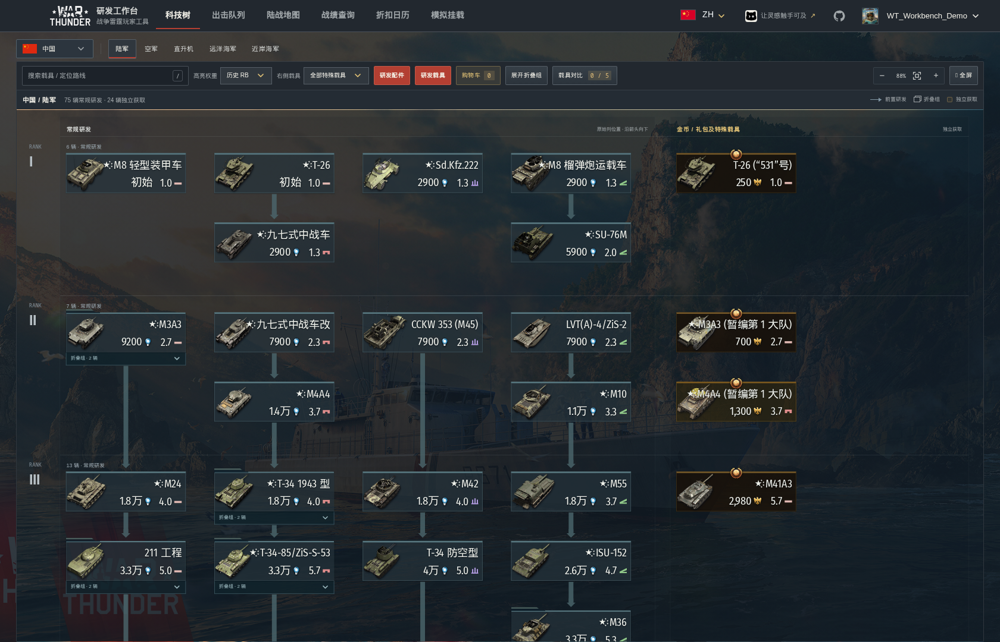
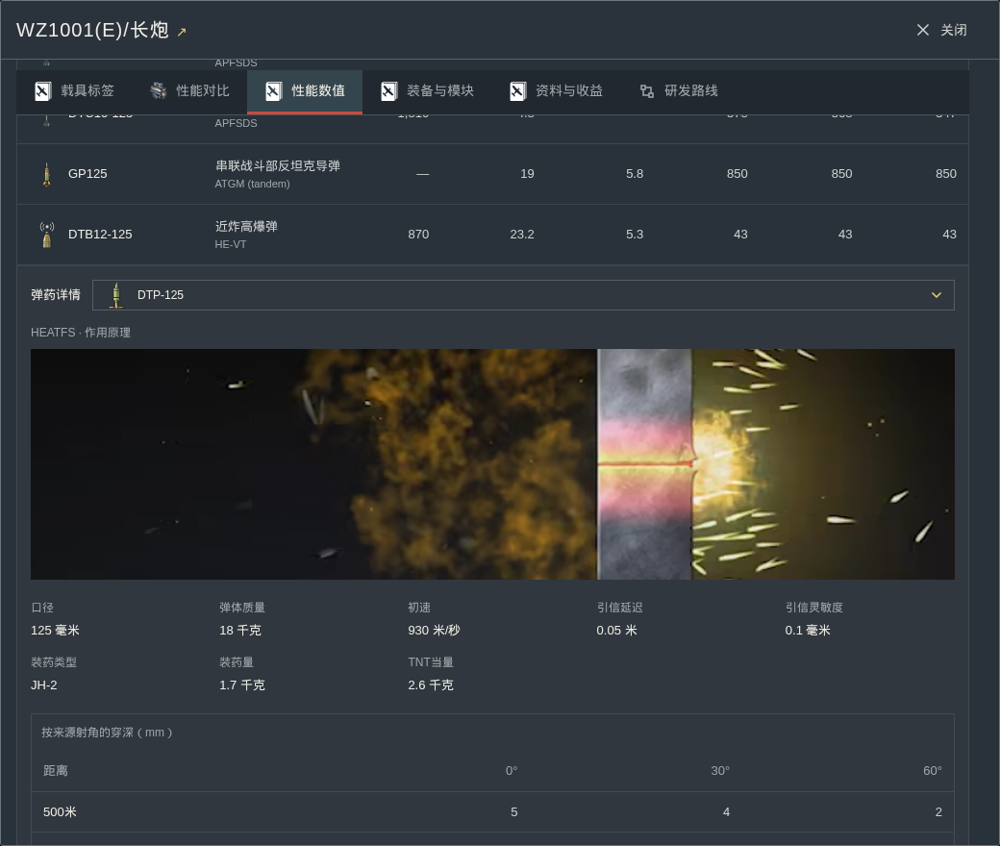
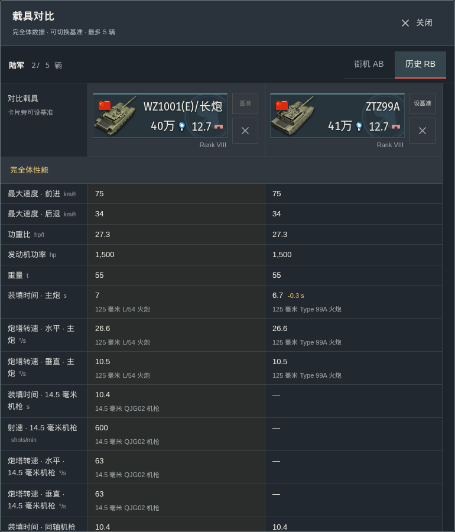
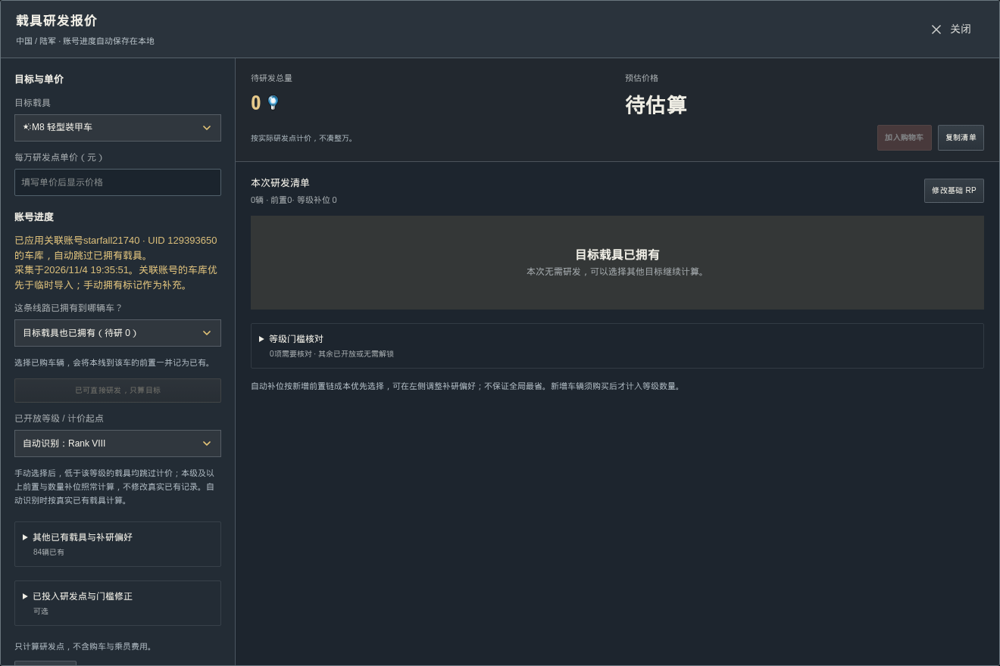
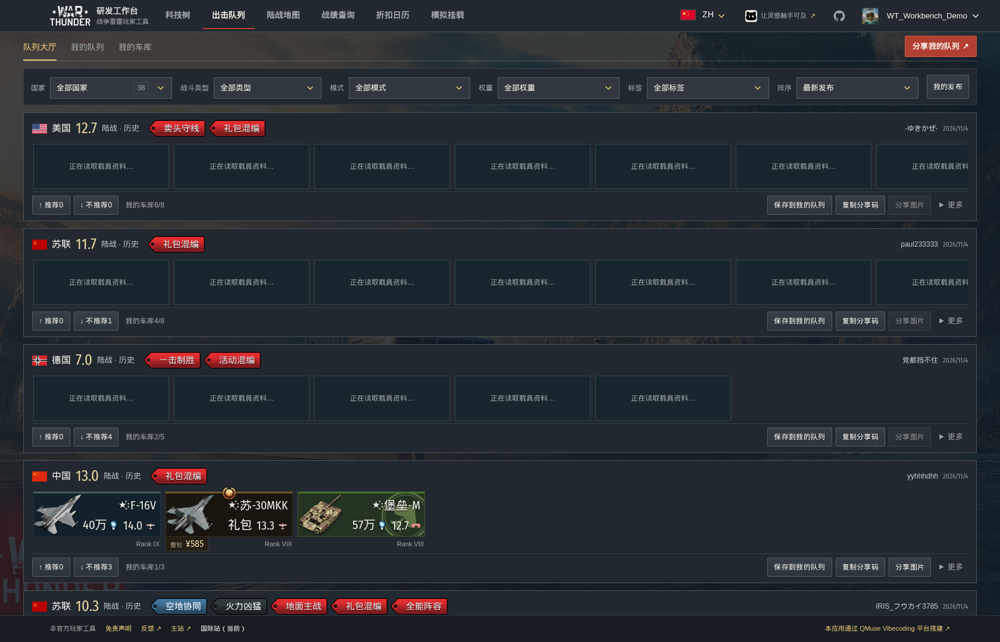
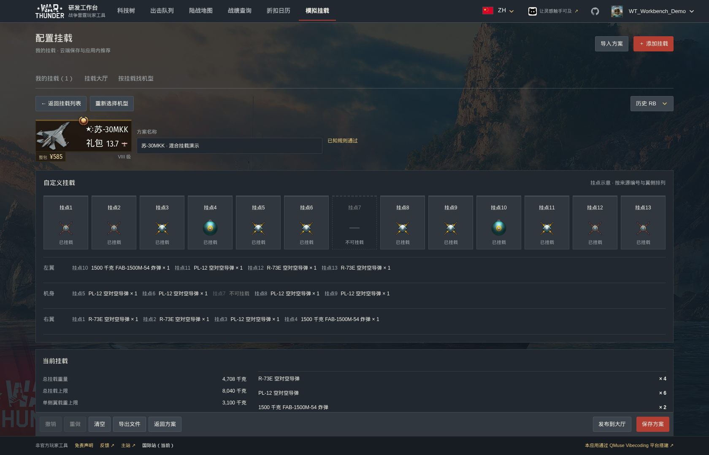
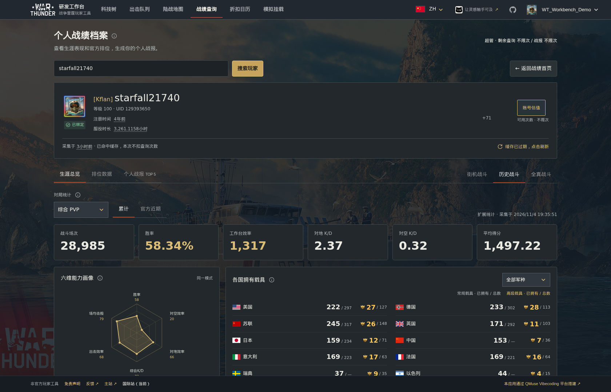
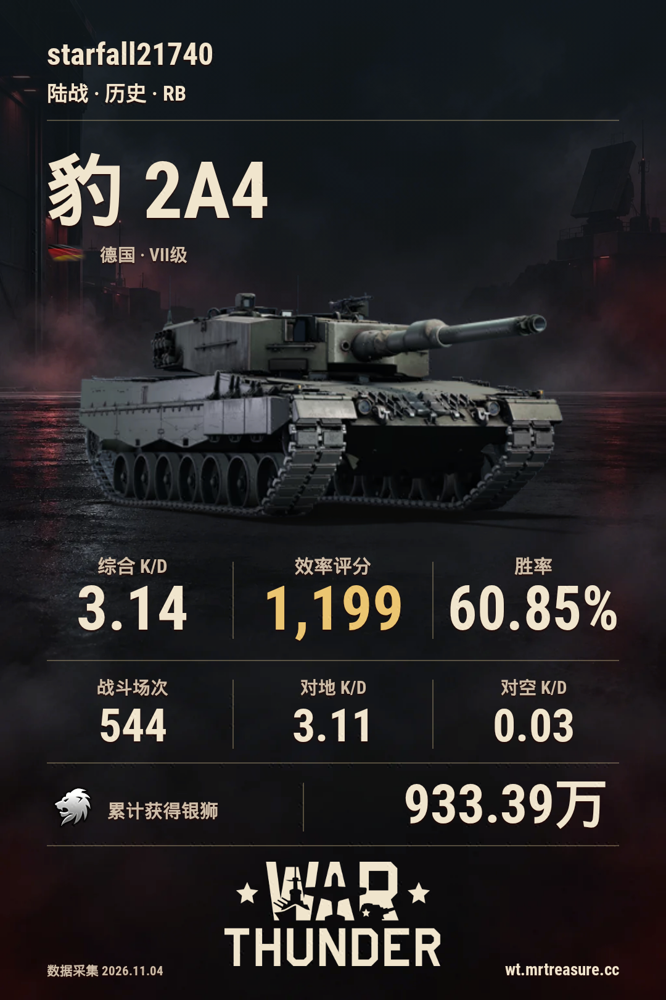
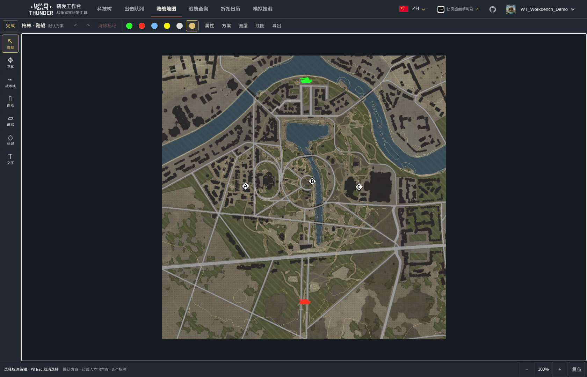
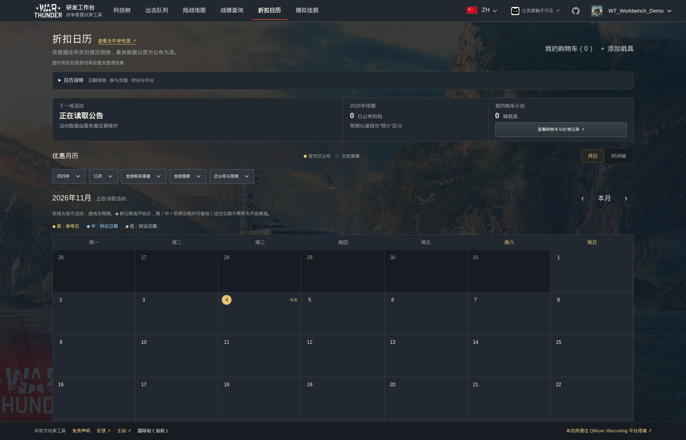

[简体中文](README.md) · [English](README.en.md) · [Русский](README.ru.md) · [日本語](README.ja.md)

# War Thunder Research Workbench

Explore vehicles, plan research, configure loadouts, save lineups, review statistics and draw map routes.

**[Main site](https://wt.app.qmuse.pub/)** · **[International site](https://wt.mrtreasure.cc/en/)** · [User guide](docs/usage.en.md) · [Report an issue](https://github.com/MrTreasure/war-thunder-workbench/issues)

## Modules

| Module | What it offers |
| --- | --- |
| Research trees | Ten nations, five branches, research planning, modifications and vehicle comparison |
| Lineups | Saved rosters, mode-specific battle ratings, sharing and the community lobby |
| Loadout simulator | Hardpoint configuration, missile comparison, aircraft search and bombing estimates |
| Statistics and reports | Career/recent statistics, official rankings, garage, reference valuation and share cards |
| Ground maps | Mission layouts, contours, tactical annotations and image export |
| Sale calendar | Official events, estimated windows and a vehicle watchlist |

## Research trees and planning

Browse ground vehicles, aircraft, helicopters, bluewater and coastal fleets across ten nations. Search by name, filter by rank/type, switch battle-rating modes, expand groups and follow research links.

Vehicle details include acquisition methods, verified whole-pack prices, RP/SL multipliers, performance and prerequisites. Compare up to **five vehicles of the same branch** using fully upgraded values, change the baseline and remove entries directly.

Ground vehicles show nominal armour and ammunition, with penetration at **500, 1,000 and 2,000 m**. Selecting ammunition opens its original game AVIF diagram in the detail area. Equipment includes sourced radar, optics and modules; ammunition modules use matching shell icons. Aircraft and helicopter details also list supported weapons.

Research planning accounts for owned vehicles, unlocked ranks and existing progress. Modifications retain their actual tiers and groups; premium modifications default to unlocked. A combined research cart counts shared prerequisites once. User-entered RP prices are reference conversions; unknown costs are not treated as zero.

## Lineups

Save multiple rosters per nation, reorder crew slots, filter configurations and sort by battle rating. Nation selectors include flags and counts. Ratings follow the selected battle type and mode.

Browse community lineups, recommend or downvote, save a copy, add tags and export a share image. Lineup codes preserve the nation and slot order. Draft changes take effect only when saved.

## Loadout simulator

Sign in to open saved configurations or add an aircraft. Use default presets or configure individual hardpoints, review left-wing/fuselage/right-wing loads and hover weapons for details.

Compare up to **six missiles**, filter by weapon family/type and search for aircraft that can carry a specified quantity. Saved loadouts can be recommended in the lobby and linked to the aircraft's detail page.

For supported high-explosive bombs, Air RB ratings and common respawning four-base rules provide damage, bombing reward multipliers and estimated bases destroyed across matchmaking ranges. Loadouts use in-app records and associations, without loadout share codes.

## Statistics and personal reports

Read public profiles, career and official recent statistics, branch K/D, capability charts, vehicle usage and official rankings. Vehicle records support filters, sorting, pagination and card/table views.

Create personal reports or individual vehicle cards with selectable backgrounds and commentary styles. Vehicle flags follow verified national markings, distinguishing modern Germany, the Russian Federation and historical flags independently of background style. Chinese vehicles always use the five-star red flag.

A linked account can display the full garage, including vehicles never used in battle. The spade marks ownership, not completed modifications. Reference valuation lists verified components and unpriced items separately; it is not an official price or a transaction quote.

## Ground maps and tactical drawing

Search maps, select a mission layout and team, and view contours, spawns, capture points and original guides. Draw lines, curves, arrows, defensive lines, areas, symbols and text, with undo/redo and multiple local plans. Export **2K/4K PNGs** or editable drawing files.

## Sale calendar

Review official events and sources in calendar or timeline views. Watch GE vehicles and store packs, including verified regular prices, whole-pack CNY quotes and price history. Official announcements and historically estimated windows remain distinct.

## Languages, storage and privacy

The international site supports Simplified Chinese, English, Russian and Japanese on desktop and mobile. Guest plans stay in the current browser; signed-in research plans, carts, lineups and watch settings can sync through the account workspace. The loadout simulator requires sign-in.

Map plans remain local. Completing a drawing records vector data, retaining only the latest valid snapshot per user/device, map, layout and team; no screenshot or image is uploaded. Reports, cards and map exports are generated in the browser. Public profile lookup does not require a Gaijin password.

Screenshots show the newly published Chinese production UI. Versions, capture times and provenance are listed in the [screenshot index](docs/screenshots/README.md).

## Documentation and credits

[User guide](docs/usage.en.md) · [Documentation](docs/README.md) · [Contributing](docs/contributing.md)

Game data and assets come from the [official War Thunder Wiki](https://wiki.warthunder.com/), [Gaijin Store](https://store.gaijin.net/) and official public sources. Community material retains its attribution.

This is an independent, unofficial player project with no Gaijin endorsement. Game information may change; in-game information and official announcements take precedence. Scores, valuations and predictions are reference outputs.

War Thunder names, trademarks, images, maps and original assets belong to Gaijin Entertainment or their respective owners. The [MIT licence](LICENSE) covers original project code, not a relicensing of third-party content. Rights holders may contact us through [GitHub Issues](https://github.com/MrTreasure/war-thunder-workbench/issues) with the affected material and ownership details.
