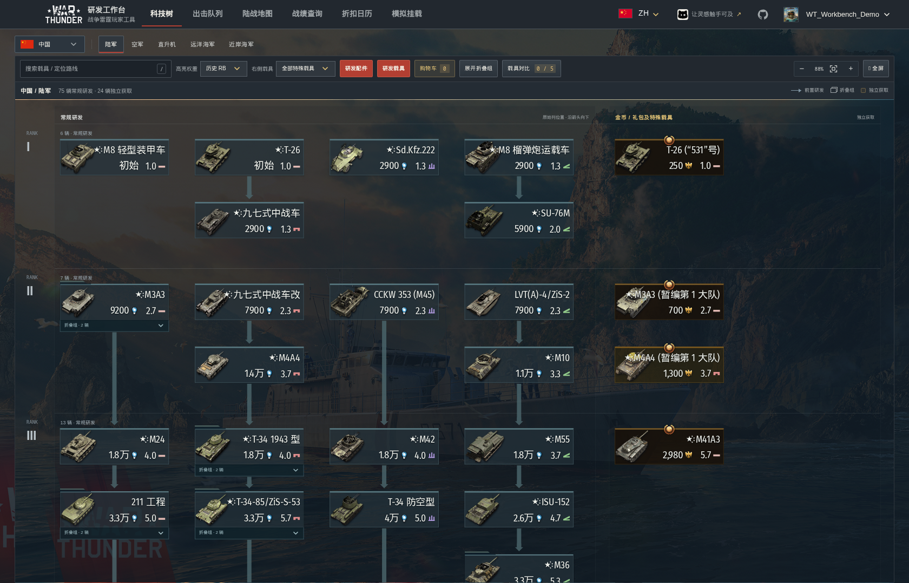
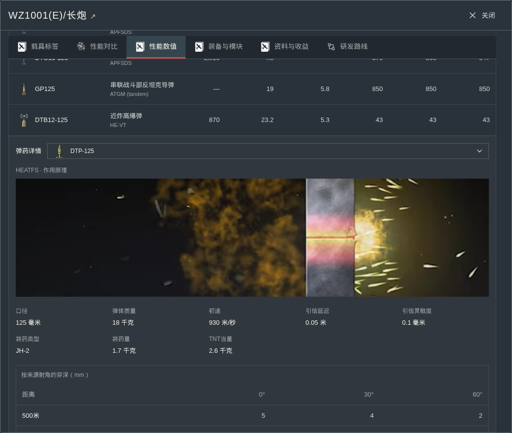
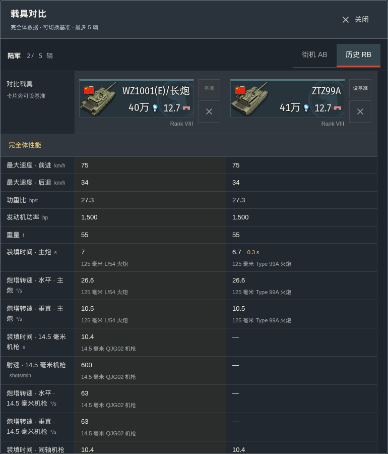
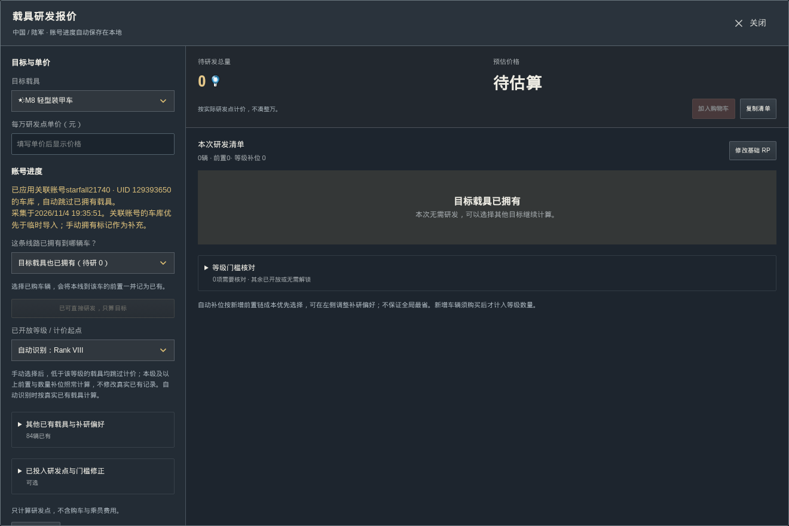
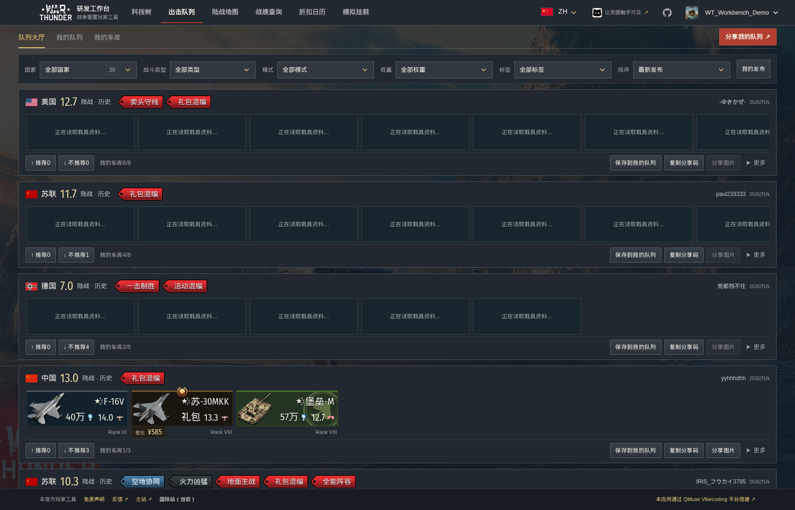
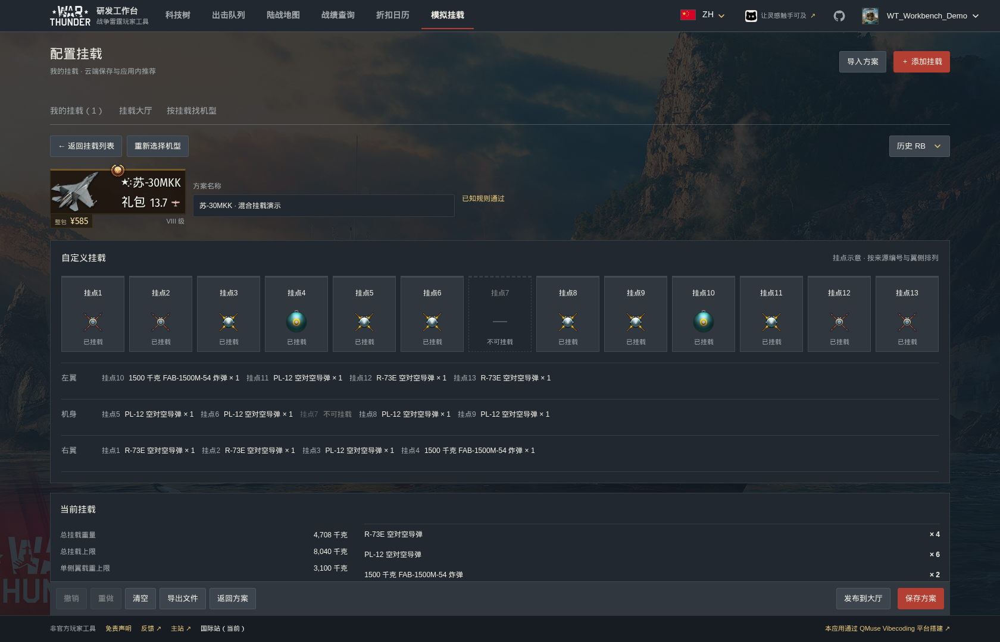
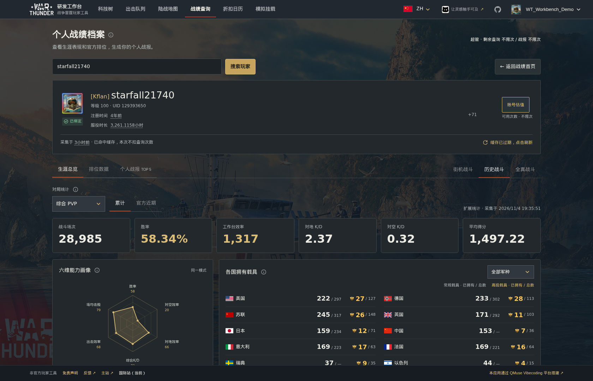
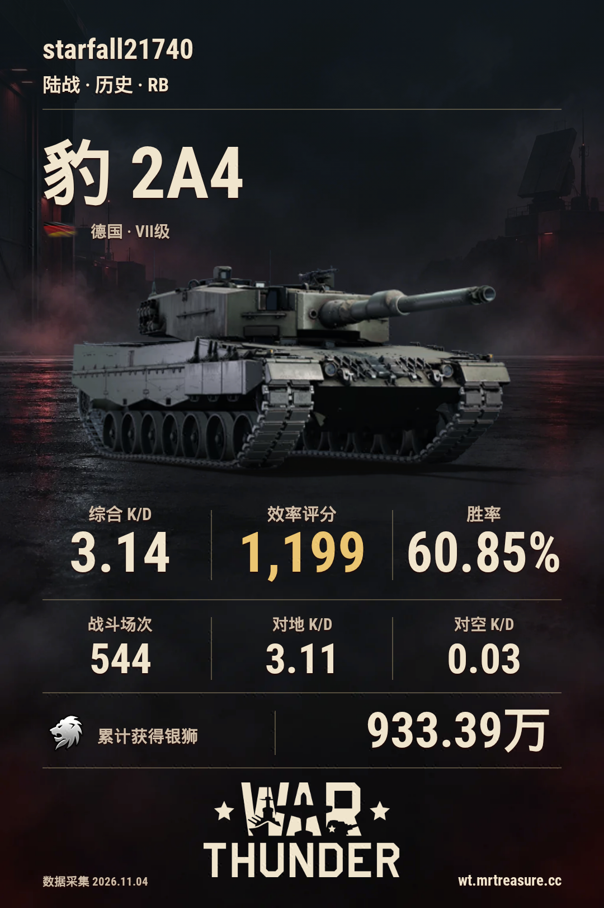
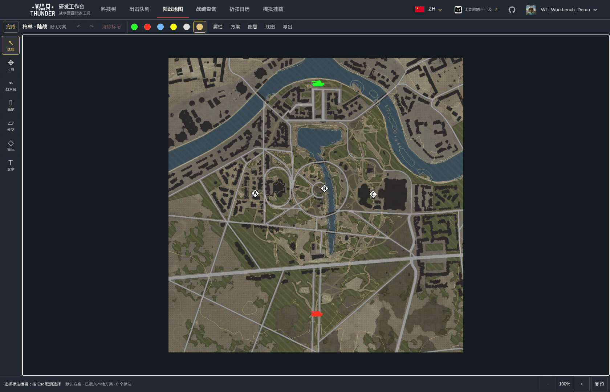
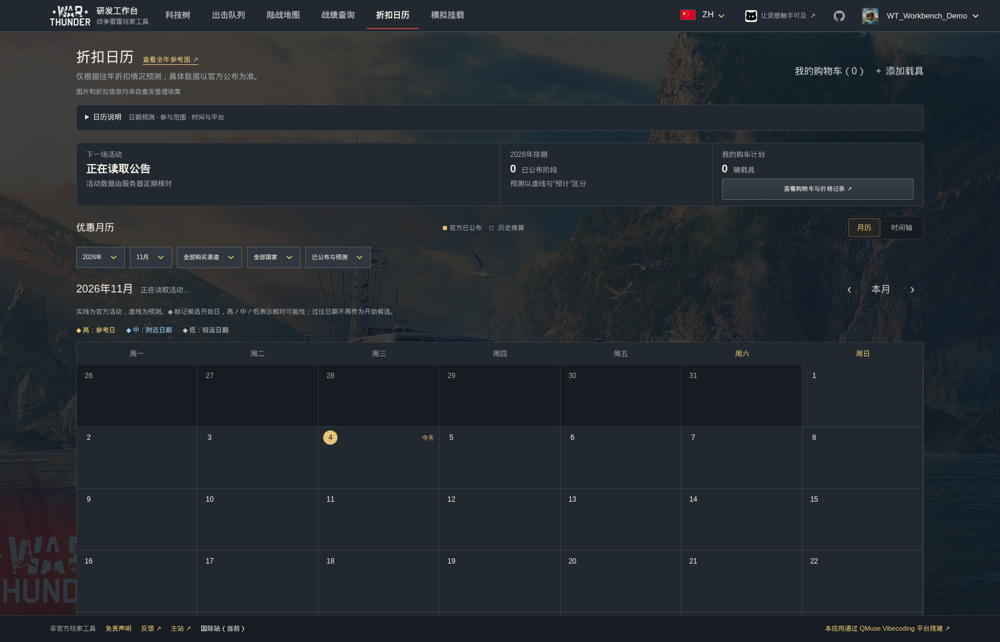

[简体中文](README.md) · [English](README.en.md) · [Русский](README.ru.md) · [日本語](README.ja.md)

# War Thunder 研究ワークベンチ

車両資料の確認、研究計画、兵装設定、編成、戦績確認、マップ上のルート作成をまとめて行えます。

**[メインサイト](https://wt.app.qmuse.pub/)** · **[国際版](https://wt.mrtreasure.cc/ja/)** · [使い方](docs/usage.ja.md) · [問題の報告](https://github.com/MrTreasure/war-thunder-workbench/issues)

## 機能一覧

| 機能 | 主な内容 |
| --- | --- |
| 研究ツリー | 10か国・5兵科の資料、研究計画、改修、車両比較 |
| 出撃編成 | 編成保存、モード別BR、共有、編成ロビー |
| 兵装シミュレーター | 懸架点設定、ミサイル比較、搭載可能機の検索、基地破壊の試算 |
| 戦績・レポート | 生涯・最近の成績、公式順位、ガレージ、参考評価、共有カード |
| 陸戦マップ | ミッション配置、等高線、戦術描画、画像出力 |
| セールカレンダー | 公式イベント、予想期間、車両のウォッチリスト |

## 研究ツリーと研究計画

10か国の陸軍、航空機、ヘリコプター、大型艦艇、小型艦艇に対応。名前検索、ランク・種類の絞り込み、BRモードの切り替え、グループ展開、研究経路の確認ができます。

詳細には入手方法、確認済みのパック全体価格、RP・SL倍率、性能、前提車両を掲載。同じ兵科の車両を最大 **5両**、改修完了状態のデータで比較でき、基準車両の変更や個別削除にも対応しています。

戦車には公称装甲と弾薬、**500・1,000・2,000m**の貫徹力を表示。弾薬を選ぶと、詳細欄にゲーム原本のAVIF原理アニメーションが表示されます。装備欄には出典で確認できるレーダー、光学装置、改修項目を掲載し、弾薬項目には対応する画像を使用します。航空機・ヘリコプターの搭載可能な武器も確認できます。

研究計画は所有車両、開放済みランク、投入済みRPを考慮します。改修項目は実際の段階・グループで表示し、プレミアム車両は標準で改修済みとして扱います。複数目標の研究カートでは共通の前提車両を重複計上しません。手入力のRP単価は参考換算であり、不明な費用をゼロにはしません。

## 出撃編成

国ごとに複数の編成を保存し、搭乗員スロットを並べ替え、絞り込みやBR順の表示ができます。国選択には国旗と編成数を表示し、BRは戦闘の種類とモード別のルールで計算します。

ロビーでは編成の閲覧、評価、コピー保存、タグ設定、共有画像の作成に対応。編成コードは国とスロット順を保持します。新規作成や編集は、保存した時点で反映されます。

## 兵装シミュレーター

ログイン後、保存済みの設定を開くか機体を追加します。標準プリセットと懸架点ごとの設定、左翼・胴体・右翼の荷重確認、武器にカーソルを合わせた詳細表示に対応します。

ミサイルは最大 **6発**を比較できます。武器の系列・種類を絞り込み、指定した数を搭載できる機体を逆引きできます。おすすめの兵装設定はロビーと対応機体の詳細に関連付けられます。

対応する通常爆弾と空戦RBのBR、再出現する4基地ルールに基づき、ダメージ、爆撃報酬倍率、マッチング範囲別の基地破壊数を試算します。兵装設定はアプリ内で保存・関連付けし、専用の兵装共有コードは使用しません。

## 戦績と個人レポート

公開プロフィール、生涯・公式の最近の成績、兵科別K/D、能力グラフ、使用時間、公式順位を確認できます。車両記録には絞り込み、並べ替え、ページ切り替え、カード・表形式があります。

背景やコメントのスタイルを選び、個人レポートや単車両カードを作成できます。国旗は車両ごとの確認済みの所属に対応し、現代ドイツ、ロシア連邦、歴史上の旗を区別します。背景の時代設定で国旗は変更されません。中国車両には常に五星紅旗を使用します。

アカウントを関連付けると、未出撃の車両を含むガレージも確認できます。所有マークは改修完了を意味しません。参考評価では確認済みの項目と価格不明の項目を分け、公式価格や売買価格としては扱いません。

## 陸戦マップと戦術描画

マップを検索し、ミッション配置と陣営を選択。等高線、出現地点、占領地点、元の攻略を参照できます。直線、曲線、矢印、防御線、領域、記号、文字の描画、元に戻す・やり直す、複数のローカル案に対応。**2K・4K PNG**と再編集用ファイルを出力できます。

## セールカレンダー

公式イベントと出典を月表示・タイムラインで確認。GE車両とストアパックを登録し、確認済みの通常価格、パック全体の人民元価格、価格履歴を参照できます。公式発表と過去の実績からの予想期間は区別して表示します。

## 言語・保存・プライバシー

国際版は簡体字中国語・英語・ロシア語・日本語に対応し、PC・スマートフォンで利用できます。ゲストの計画は現在のブラウザーに保存されます。ログイン後は研究計画、カート、編成、ウォッチ設定を同期できます。兵装シミュレーターにはログインが必要です。

マップ案はローカルに保存されます。「完了」時には描画データを記録し、同じユーザー・端末、マップ、配置、陣営ごとに最新の有効な案だけを保持します。スクリーンショットや画像はアップロードしません。出力画像はブラウザー内で生成し、公開戦績の検索にGaijinパスワードは不要です。

画像は更新後の中国語版公開サイトで撮影しています。バージョン、撮影日時、出典は[画像一覧](docs/screenshots/README.md)をご覧ください。

## ドキュメントと権利

[使い方](docs/usage.ja.md) · [ドキュメント](docs/README.md) · [開発・貢献](docs/contributing.md)

データとゲーム素材は[公式War Thunder Wiki](https://wiki.warthunder.com/)、[Gaijinストア](https://store.gaijin.net/)などの公式公開情報に基づき、コミュニティ資料の出典も保持します。

本ツールはプレイヤーによる非公式プロジェクトで、Gaijinの公認・提携を意味しません。ゲーム内情報と公式発表を優先してください。評価・予測は参考情報です。

War Thunderの名称、商標、画像、マップ、ゲーム原本素材はGaijin Entertainmentまたは各権利者に帰属します。[MITライセンス](LICENSE)は本プロジェクト独自のコードに適用され、第三者素材を再許諾するものではありません。権利者からの連絡は[GitHub Issues](https://github.com/MrTreasure/war-thunder-workbench/issues)で受け付けます。
