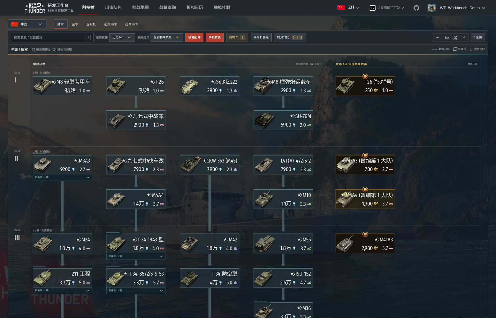
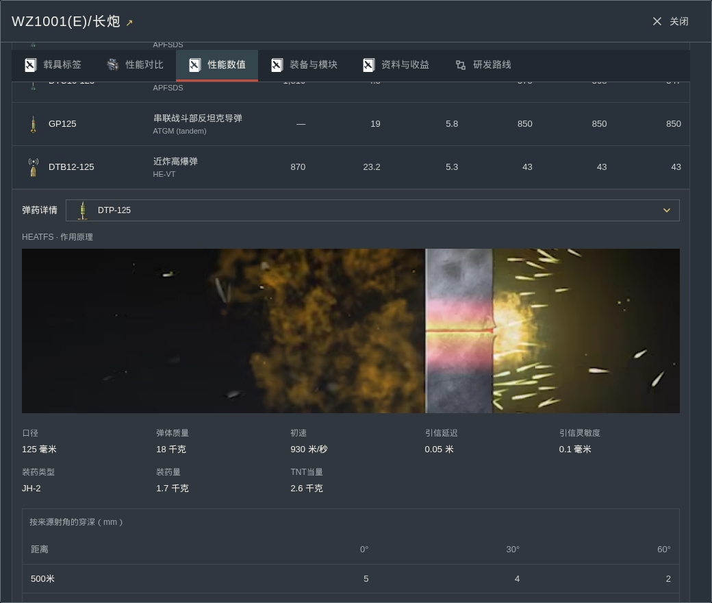
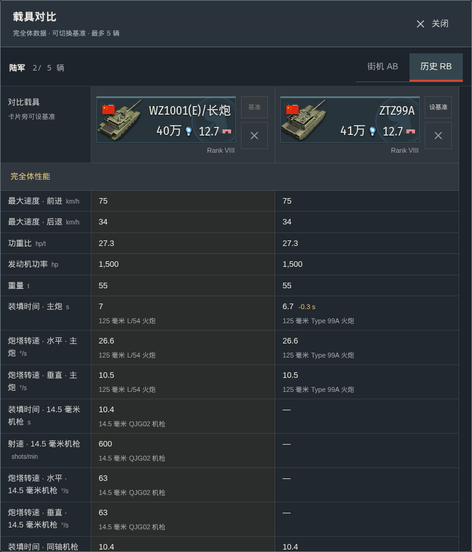
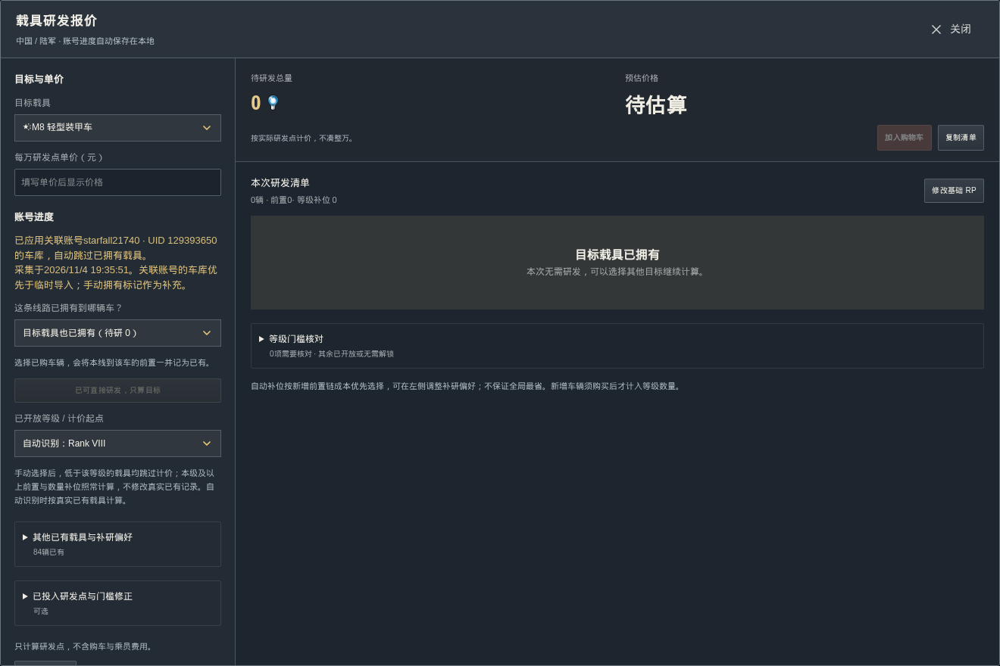
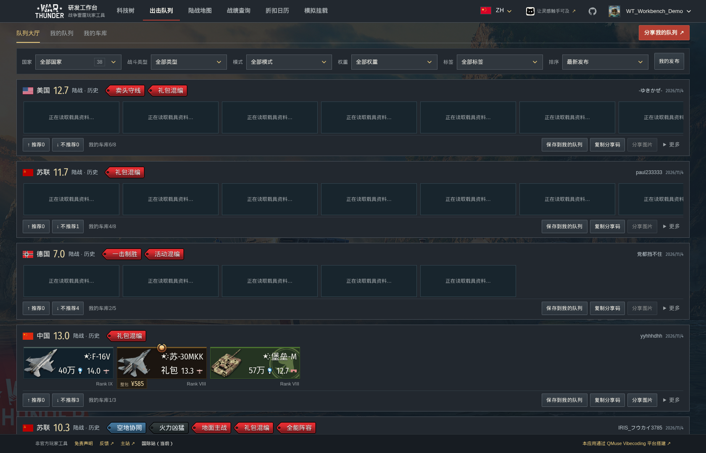
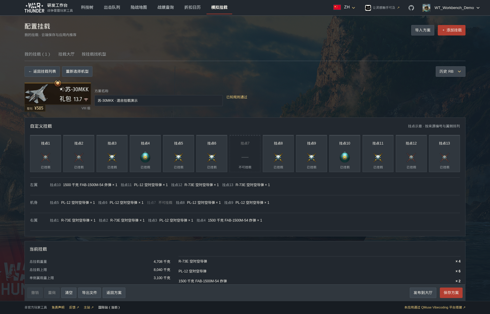
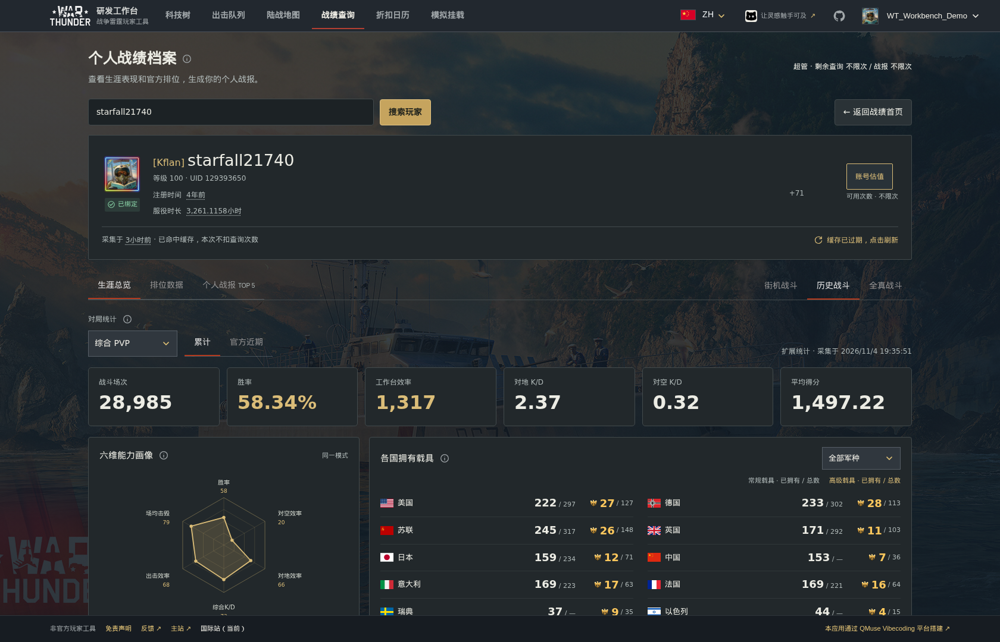
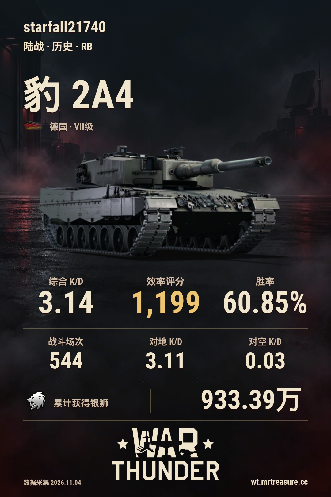
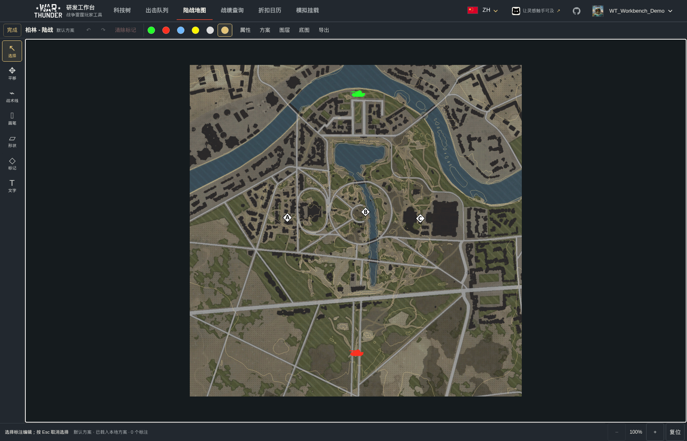
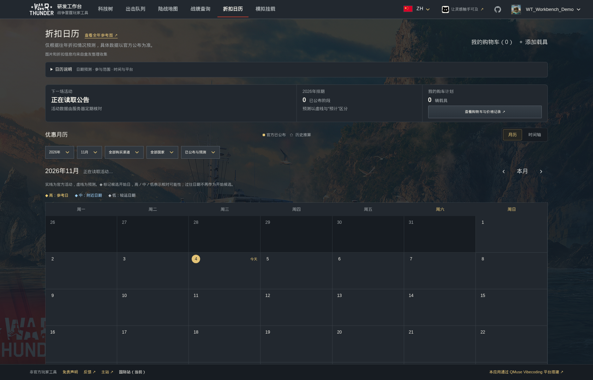

[简体中文](README.md) · [English](README.en.md) · [Русский](README.ru.md) · [日本語](README.ja.md)

# 战争雷霆 · 研发工作台

查资料、算研发、配挂载、存队列、看战绩、画走线。

**[打开主站](https://wt.app.qmuse.pub/)** · **[打开国际站](https://wt.mrtreasure.cc/zh/)** · [使用指南](docs/usage.zh-CN.md) · [反馈问题](https://github.com/MrTreasure/war-thunder-workbench/issues)

## 功能模块

| 模块 | 可以做什么 |
| --- | --- |
| [科技树与研发规划](#科技树与研发规划) | 十国五军种资料、研发路线、配件与购物车、完全体对比 |
| [出击队列](#出击队列) | 保存阵容、检查模式权重、导入分享、浏览队列大厅 |
| [模拟挂载](#模拟挂载) | 配置挂点、对比导弹、按武器找机型、估算炸区数量 |
| [战绩与个人战报](#战绩与个人战报) | 生涯与近期统计、官方排位、完整车库、参考估值、战报导出 |
| [陆战地图与走线](#陆战地图与走线) | 查看任务布局、等高线与攻略，绘制和导出战术方案 |
| [折扣日历](#折扣日历) | 查看官方活动、历史预计窗口，关注金鹰载具和商城礼包 |

## 科技树与研发规划

覆盖美国、德国、苏联／俄联邦、英国、日本、中国、意大利、法国、瑞典和以色列，以及陆军、航空、直升机、远洋海军和近岸海军。支持搜索、等级与类型筛选、模式权重切换、折叠组展开及缩放。

**载具详情与对比**

- 查看获取方式、已核验整包价格、RP／银狮收益、性能和研发前置。
- 同军种最多对比 **5 辆**，仅比较完全体数据；可重新设置基准、直接移除载具，差异紧随数值显示。
- 坦克展示标称装甲、武器与弹药，穿深保留 **500／1,000／2,000 米**。选择弹药后，在详情中查看对应的原始游戏 AVIF 原理动图。
- 装备页列出配件模块、动力与观瞄设备，以及来源明确提供的雷达和告警能力；弹药模块使用匹配的弹药图标。飞机和直升机还可查看支持挂载的武器及详细参数。

**研发计算与购物车**

按已有载具、已开放等级和投入进度计算必要前置与等级补位。配件按实际等级和栏目展示，支持标记已完成项目；高级载具按默认已解锁配件处理。多个目标合并到研发购物车时，共用前置只计一次。

自填单价只用于“剩余 RP ÷ 10,000 × 单价”的参考换算；未知成本不按零计算，礼包价格不拆成单车报价。

## 出击队列

按国家保存多套阵容，调整乘员槽位顺序，按国家、类型和模式筛选，并按权重排序。国家选择显示国旗与队列数量，不同战斗模式使用各自的队列权重规则。

队列大厅支持查找、推荐／不推荐和另存方案。分享时可添加标签、复制队列码或生成分享图；导入后保留国家、载具与槽位顺序。新建和编辑只在明确保存后生效。

## 模拟挂载

登录后从已保存方案开始，通过选机弹窗添加挂载。支持默认预设和自定义挂点，按左翼、机身、右翼查看配置与重量；悬停武器图标可查看参数。

- 按武器类型、系列和名称筛选；导弹最多同时对比 **6 枚**。
- 指定武器和至少携带数量，反查可配机型。
- 保存方案、分享到大厅并打标，已推荐方案显示推荐标签；推荐同时关联至对应机型详情。
- 结合空历权重、已知炸弹参数与常见可刷新四战区规则，展示伤害、炸弹收益系数，以及不同分房下的预计炸区数量。

挂载使用应用内保存与关联，不使用挂载分享码。战区测算的规则与支持范围见[模拟挂载说明](docs/loadouts.md)。

## 战绩与个人战报

按昵称读取公开资料，查看生涯、官方近期统计、军种 K/D、能力图、载具类型和游玩时长。单车记录支持筛选、排序、分页与卡片／表格切换；官方排位使用独立页面。

个人战报可按国家、军种与模式整理常用载具，选择点评风格和背景。单车战绩可生成独立卡片并复制或下载；载具国旗按已核验的实际国别展示，现代德国、俄联邦与历史旗帜分别匹配，不随卡片背景改变。

登录并关联游戏角色后，可查看包含未出击载具的完整车库。科技树黑桃表示已拥有，不代表配件全满。账号参考价值按已核验资料分项，缺少价格的项目另列；它不是官方定价或实际成交价。

## 陆战地图与走线

按中文或英文名称搜索地图，切换任务布局和己方阵营，查看出生点、占领点、等高线与原攻略。

绘图支持直线、曲线、箭头、防御阵线、区域、战术标记与文字；支持撤销／重做、多套方案、跨地图外区域绘制，以及 **2K／4K PNG** 和可继续编辑的绘图文件导出。

## 折扣日历

通过月历或时间轴查看官方活动、适用范围和公告来源，关注金鹰载具与商城礼包，并查看已核验的原价、整包人民币价格和历史变化。

官方已公布活动与历史预计窗口分开展示。预计时间和参与范围以当次官方公告为准。

## 语言、保存与隐私

- 国际站支持简体中文、English、Русский、日本語；主站以中文为主，网页适配桌面和移动端。
- 游客数据保存在当前浏览器；登录后，研发计划、研发购物车、队列及关注设置可通过账号工作区同步。模拟挂载需要登录。
- 地图方案在本地独立保存。点击“完成”时会记录绘图数据，后台仅保留同一用户／设备、地图、布局和阵营的最新有效快照，不上传截图或图片。
- 战绩卡片、战报与地图图片在浏览器生成。查询公开战绩不需要提供 Gaijin 密码。

本页配图在本次双站更新后重新拍摄；来源、版本、拍摄时间和校验信息见[截图清单](docs/screenshots/README.md)。

## 使用与维护

[使用指南](docs/usage.zh-CN.md) · [文档索引](docs/README.md) · [本地开发与贡献](docs/contributing.md) · [问题反馈](https://github.com/MrTreasure/war-thunder-workbench/issues)

## 数据来源与版权

科技树、载具、配件、战绩、商城价格、地图和原始游戏资源整理自[战争雷霆官方 Wiki](https://wiki.warthunder.com/)、[Gaijin 官方商城](https://store.gaijin.net/)及官方公开渠道；社区攻略等补充资料保留各自出处。

这是玩家独立开发的非官方工具，与 Gaijin Entertainment 无隶属或官方背书关系。游戏资料随版本变化，以游戏内信息和官方公告为准；工作台评分、估值和预测属于工具提供的参考结果。

War Thunder 名称、商标、图像、地图和原始游戏资源归 Gaijin Entertainment 或相应权利人所有。[MIT 许可证](LICENSE)仅适用于本项目原创代码，不构成第三方内容的再次授权。权利人可通过 [GitHub Issues](https://github.com/MrTreasure/war-thunder-workbench/issues)提供具体页面、权属说明与处理诉求；核实后将更正、替换或移除相关内容。
