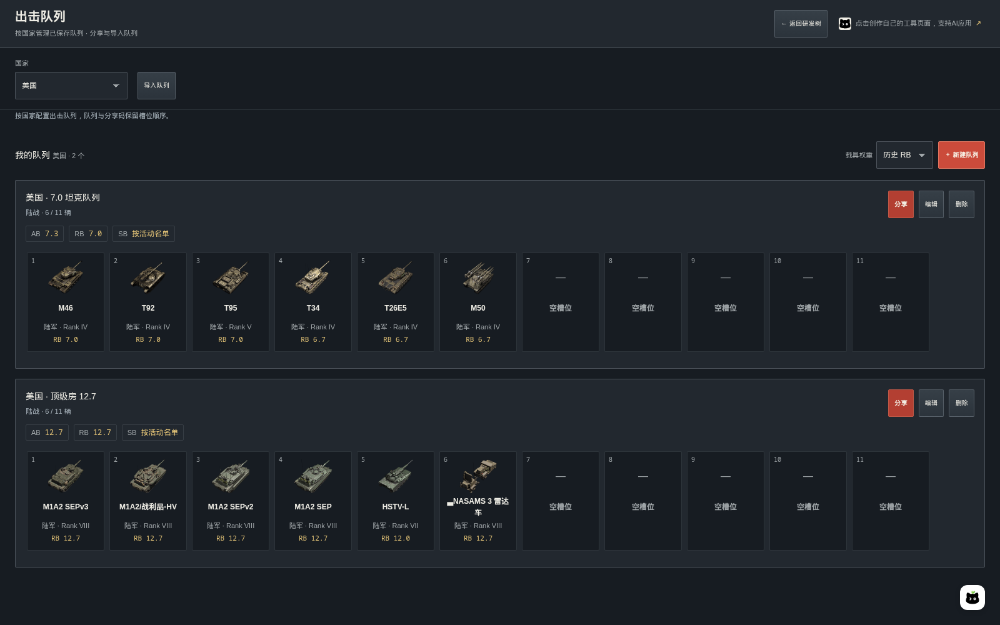

# War Thunder 研发工作台

一个面向《战争雷霆》玩家的中文研发与配队工具：查看科技树、规划载具与配件研发、估算研发点与费用，以及管理和分享出击队列。

**[在线体验 →](https://render.qmuse.pub/p/muse/8645013411493394)** · [功能预览](#功能预览) · [本地运行](#本地运行) · [数据与计算](#数据与计算) · [参与贡献](#参与贡献)


> 本项目是玩家自制的非官方工具，与 Gaijin 无隶属关系。数据是带核对时间的快照，实际载具、研发点、分房权重与解锁要求以游戏内为准。

## 能做什么

- **看科技树**：十个国家、陆军 / 航空 / 远洋舰队 / 近海舰队，保留前置关系与折叠组，区分常规和特殊载具。
- **算载具研发**：结合已有载具、目标前置、等级门槛与补研偏好生成待研清单，支持手动设置计价起点。
- **算配件研发**：独立计算单车配件成本，扣除已完成配件与其余已投入 RP。
- **管出击队列**：按国家保存多个队列，11 个有序槽位，展示各模式权重，支持拖动排序和分享码导入导出。
- **汇总报价**：自填每万 RP 单价，将载具和配件报价加入本地购物车，共享载具前置去重。
- **保存在本地**：研发进度、队列与购物车留在当前浏览器，无需登录，不连接游戏账号。

## 功能预览

以下截图由 Playwright 在[线上应用](https://render.qmuse.pub/p/muse/8645013411493394)实拍，截图日期为 **2026-10-20**，所用数据核对日期为 **2026-10-19**。截图中的账号进度、单价与队列均为演示设置，不代表真实账号或官方报价。

### 1. 首页：先选择国家

首次打开时展示国家入口，不提前下载载具与配件资料。选择国家后，一次加载该国全部军种、载具、配件与分享码字典；同国内切换军种无需再加载另一份数据。再次访问会恢复上次选择。


### 2. 科技树：保留研发关系

沿箭头查看前置载具，展开折叠组，搜索中文或英文型号并定位路线。AB / RB / SB 切换后，卡片展示对应模式的权重。金币、礼包、联队、活动等独立获取载具与常规研发分区展示；支持缩放与全屏。


点击载具可查看大图和研发资料，标题直达官方 Wiki，两个入口分别进入载具研发与配件研发。


### 3. 载具研发：按账号进度生成清单

选择目标、填写已有载具和单价后，工具计算目标、必要前置与等级补位。已有记录、目标已投入 RP、数量门槛和手工核对项共同构成报价依据；未知 RP 会提示核对，不直接视为零。

#### 不同等级的计价起点

“已开放等级 / 计价起点”用于表达账号已经走到哪一级。低于起点的载具不计价，同级及以上的必要前置、数量门槛仍参与计算；这一设置不会把低级载具写成真实已拥有。

以下以 **ZTZ99A** 为目标、每万 RP **¥12.50** 为演示单价，其他已有记录保持为空：

| 设置 | 演示结果 | 含义 |
| --- | --- | --- |
| 从 Rank VIII 计价 | 810,000 RP / ¥1,012.50 | 包含同级前置 WZ1001(E)/长炮和目标 |
| 从 Rank VII 计价 | 2,065,000 RP / ¥2,581.25 | 继续计入 VII 级必要前置与补位 |


#### 自定义筛选与补研偏好

在“其他已有载具与补研偏好”中，型号搜索、Rank 等级和载具类型可以组合使用。“已有载具”记录已购买或领取的车辆；“补研选择”可指定、排除或自动选择补位车辆。筛选只改变列表展示，不会清除其他等级的记录。

下图组合使用 **ZTZ 搜索 + 常规研发 + Rank VII**，同时保留右侧完整计算结果。


### 4. 配件研发：单车成本单独计算

配件面板使用独立单价。勾选已完成配件后扣除对应成本，再扣除未勾选配件中已投入的 RP，显示剩余研发量与金额。下图以 ZTZ99A、每万 RP ¥10.00、另投入 5,000 RP 为例。

完整总成本和逐项求和核对通过时，才启用逐项扣除；缺失数据可手动核对。高级载具默认已解锁配件，与 Wiki 记录的原始完整配件成本分别处理。


### 5. 出击队列：保存、配置与分享

出击队列有独立页面，默认展示当前国家已保存的队列。新建或编辑时进入配置，点击“保存队列”才写入；取消保留原先的保存结果。每条队列标题旁都有分享入口。


#### 横向槽位与筛选

乘员槽位始终横向排列，可横向滚动。拖动柄按住即可排序，卡片支持长按拖动，键盘可用 `Alt + ← / →` 调整顺序。选车支持军种、Rank、获取类型和型号搜索，区分常规、精英、礼包、联队、市场及其他特殊载具。

以下五组都是 **陆战 RB 演示队列**。队列可包含防空与轻型车辆；此处用于展示配置和权重计算，不是最优配队建议。美国“顶级房”在本次数据快照中为 **12.7**。

| 国家 | 队列 | 主要演示载具 |
| --- | --- | --- |
| 中国 | 11.7 | MBT2000、ZTZ96B、VT5、ZTZ99 (III 类)、ZBD04A、红旗-17 |
| 德国 | 5.7 | 虎式 H1、豹式 D、四号坦克/70 (V)、PaK 43 武器运载车、犀牛、东风 II |
| 德国 | 6.7 | 虎王、斐迪南、猎虎、leKPz M41、豹式 F、球形闪电 |
| 美国 | 7.0 | M46、T92、T95、T34、T26E5、M50 |
| 美国 | 顶级房 12.7 | M1A2 SEPv3、M1A2/战利品-HV、M1A2 SEPv2、M1A2 SEP、HSTV-L、NASAMS 3 雷达车 |

**中国 · 11.7**：展示常规、礼包与联队车辆混合配置，以及 Rank VII 筛选。


**德国 · 5.7**：以虎式 H1 与豹式 D 为核心，搭配坦歼和防空。


**德国 · 6.7**：展示重坦、坦歼、轻坦与防空的六车槽位。


**美国 · 7.0**：演示 M46、T92、T95 与较低权重车辆组合。


**美国 · 顶级房 12.7**：展示多辆 M1A2 与轻坦、防空系统的队列。




#### 权重规则与分享码

配置后同时展示 AB / RB / SB 的适用结果：陆战 RB 的飞机使用陆战专属权重，陆战 AB 不将飞机算入队列；陆战 SB 提示按活动名单核对，不编造一个数值分房权重。空战和海战按各自规则计算，规则来源可在页面展开查看。

分享时展示可选中文字并尝试复制；导入通过弹窗进行，无需常驻输入框。


分享码固定 **24 位，区分大小写**：前两位是国家码，其后 11 组各两位对应有序槽位，`00` 表示空位。分享码包含国家与载具顺序，不含队列名称、战斗类型和空战 RB 出击飞机选择；导入后请核对这些设置。

[示例队列、车辆 ID 与可导入分享码](docs/examples/lineups.json)保存在仓库中，可用于复现截图。

### 6. 购物车：合并研发报价

将载具与配件计算结果加入购物车，可以统一查看待研量和费用。同一国家、军种的共享载具前置会去重；单价冲突时暂停最终报价并提示核对。支持导出报价快照和复制清单。


金额按 `待研 RP ÷ 10,000 × 自填单价` 计算，使用整数分与 BigInt，最终四舍五入到分，不按整万 RP 向上取整。不含购车银狮、金币或乘员训练费用。

## 本地运行

需要 Node.js **22.12+**（或符合 Vite 8 要求的更新版本）、**pnpm 12.3.4**。刷新数据还需要 Python 3 与 curl。依赖版本已固定，请保留 `pnpm-lock.yaml`。

```bash
pnpm install --frozen-lockfile
pnpm dev
```

开发地址为 `http://localhost:5178`。开发命令会先从仓库的规范 JSON 生成国家模块，不要求先联网刷新游戏数据。

```bash
pnpm run check        # 类型、Lint 与数据一致性
pnpm run build        # 构建并检查产物与十国数据哈希
pnpm run preview      # http://localhost:4178
```

可分别运行 `pnpm run typecheck`、`pnpm run lint`、`pnpm run check:data`。页面入口为 `#/tree` 与 `#/lineups`；国家、军种和模式可通过外层查询参数指定，例如 `?country=china&category=ground&mode=rb#/tree`。

### 部署

`pnpm run build` 输出静态文件到 `dist/`，可部署到支持相对静态资源路径的站点。上传全部构建资源后再切换 HTML，并保留旧哈希资源供已打开的页面继续使用。国家资料随哈希 JS 模块发布，**不发布独立 JSON 文件**。

本仓库采用 QMuse 模板，Vite 插件统一由 `@qmuse/vite-config` 配置。使用 QMuse 时，应绑定自己的应用，再通过 qmuse-cli 导入；`.qmuse/` 为本地平台配置，不纳入 Git。`publish` / `release` 脚本是原维护环境的专用发布流程，不能直接作为通用部署命令使用。

## 数据与计算

### 数据来源

- 科技树、载具资料、图片、RP 与配件成本：[War Thunder Wiki](https://wiki.warthunder.com/)。
- 简体中文名称与等级门槛：公开的原版游戏文件镜像 [War-Thunder-Datamine](https://github.com/gszabi99/War-Thunder-Datamine)。本地 JSON 保留固定版本、原文、哈希与核对时间；它不是官方 API。
- 分房规则：来源记录在 [data/lineup-rules.json](data/lineup-rules.json)。
- Logo、国旗与壁纸使用原始官方 HTTPS 地址；图片可用性取决于对应站点。来源记录在 [data/branding.json](data/branding.json) 与 [data/flags.json](data/flags.json)。

当前快照包含 **10 国、34 棵可用科技树、3,124 条载具记录**；缺少对应军种的国家显示空状态。无法可靠匹配的少量配件名称保留英文，不使用臆测翻译。

### 数据组织与更新

| 路径 | 内容 |
| --- | --- |
| `data/trees.json`、`research.json`、`planning.json` | 科技树、研发点与等级门槛 |
| `data/modifications.json` | 配件总成本、逐项成本与核对依据 |
| `data/localization.json` | 原版简体中文映射与来源 |
| `data/lineup-rules.json`、`lineup-codebook.json` | 分房规则与稳定分享编码 |
| `src/routes/` | TanStack 文件路由 |
| `src/Workbench.tsx` | 共享状态与国家资料加载 |
| `src/generated/` | 生成的导航清单与国家 JS 运输模块 |
| `scripts/`、`schema/` | 采集、构建、校验与数据结构 |
| `docs/screenshots/`、`docs/examples/` | README 实拍截图与演示队列 |

```bash
pnpm run refresh               # 联网刷新规范 JSON，不发布
pnpm run refresh:localization  # 单独更新中文映射
pnpm run check
pnpm run build
```

刷新失败保留此前的核对数据与时间，不把失败请求标记成新快照。RP 未知与零成本有明确区别；配件逐项成本须核对完整总额。等级自动补位提供有效方案，不承诺全局最省。

分享编码字典只追加，不能重排、重编号或复用退休编码，以保证旧分享码稳定。

### 本地存储

研发账号进度、配件进度、购物车与队列使用各自独立的本地存储键。资料缓存优先 OPFS，失败时回退 localStorage，使用前核对 SHA256、字节数与结构。缓存淘汰只清理资料缓存，不清理个人进度或队列。

这些数据不自动跨浏览器、设备或域名同步，也不会从游戏账号自动读取；清除站点数据会移除本地记录，请按需导出购物车或保存队列分享码。

## 参与贡献

欢迎提交功能建议、数据问题与修复。反馈数据问题时，请附上国家、军种、载具名称、模式、游戏版本和可核对来源；界面问题请附截图与屏幕尺寸。

提交代码前运行 `pnpm run check` 与 `pnpm run build`。载具数据和来源应维护在 `data/*.json`，不要写进 JSX；同时保留已有存储格式与分享码兼容性。开发约定见 [AGENTS.md](AGENTS.md)。

## 许可与致谢

代码的开源许可证将在正式公开前确认；当前预览尚未授予额外许可。War Thunder 名称、商标、游戏图片及第三方数据归各自权利人所有，不因本仓库公开而改变其授权条件。

感谢 War Thunder Wiki、游戏文件镜像维护者，以及 QMuse 开发模板与托管服务。
