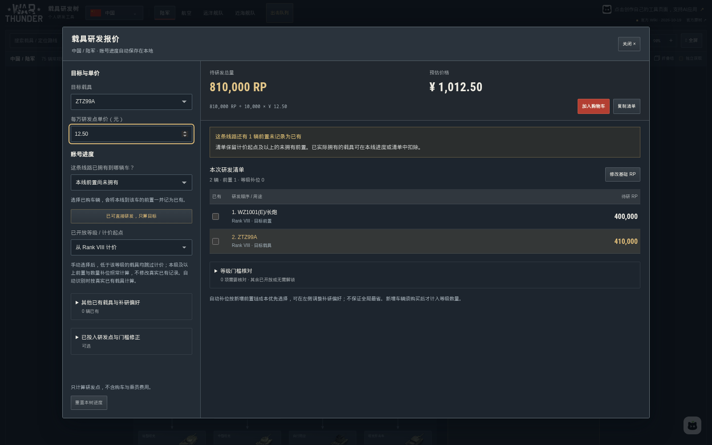
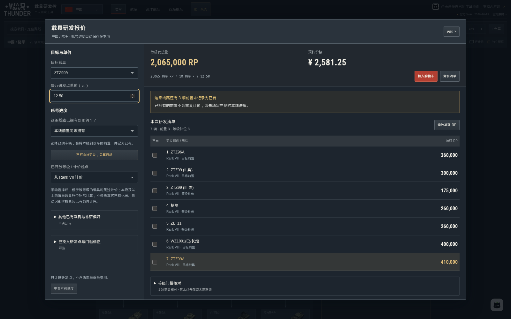
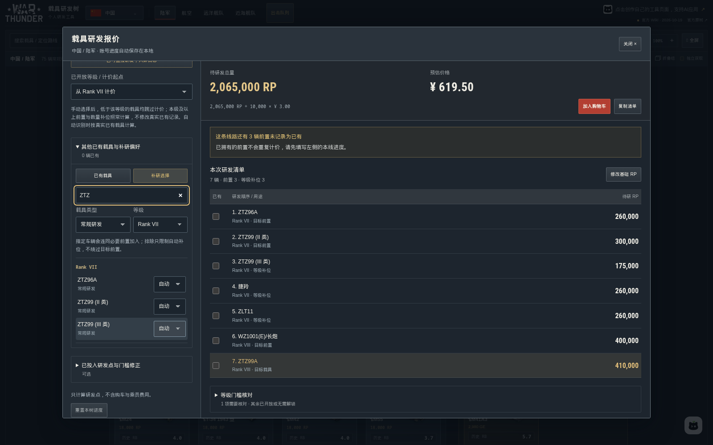

# WarThunder 载具研发科技树 + 研发速算 + 队列配置

给《战争雷霆》玩家做的一个中文小工具：查科技树、算研发、搭队列，也能看陆战地图、画自己的战术走线、查生涯战绩和生成个人战报。

**[在线体验 →](https://render.qmuse.pub/p/muse/8645013411493394)** · **[陆战地图与走线绘制 →](https://render.mrtreasure.cc/muse/war-thunder-trees/#/maps)** · **[战绩与战报预览 →](https://render.mrtreasure.cc/muse/war-thunder-trees/#/stats)** · [功能介绍](#功能介绍)

## 能帮你做什么

- **查车**：查看十国科技树，支持陆军、空军、直升机、远洋海军和近岸海军。
- **算研发**：按已有载具和已开放等级，算出目标还差多少研发点。
- **算配件**：勾选已经完成的配件，查看剩余研发量。
- **搭队列**：按国家保存多套出击队列，查看不同模式的权重，一键复制分享码。
- **看地图**：搜索陆战地图，切换任务布局，查看等高线、占领点和出生点。
- **画走线**：绘制进攻箭头、曲线、绿色防御阵线，标出狙击点和危险区域。
- **查战绩**：查看生涯总览、六维能力图、分军种 K/D，以及有出击记录的载具和累计银狮。
- **生成战报**：选出最常用的五辆载具，搭配战雷背景、本人头像和司令授勋风格的 AI 致辞，保存成图片。
- **发给队友**：将战术图保存成图片，或导出绘图文件，留着下次继续修改。

电脑、手机都可以打开。科技树、队列和地图无需登录；战绩按游戏昵称查询公开资料，无需提供游戏密码。登录工具账号后，按账户身份使用查询和战报额度，剩余次数会显示在页面中。

## 战绩与个人战报（预览）

[打开战绩页面](https://render.mrtreasure.cc/muse/war-thunder-trees/#/stats)，输入游戏昵称并确认玩家，即可查看公开生涯记录。支持切换街机、历史和全真模式，显示玩家自己的头像、六维能力图、陆空海分别计算的 K/D，以及有出击记录的载具。未返回的数据留空。

生成前可以筛选国家与兵种。战报包含当前模式的生涯场次、K/D、效率和胜率，再展示所选范围中最常用的五辆载具与累计银狮，并配有效率对比和击毁构成图。可在 **30 张战雷原生背景**中挑选，也可自动匹配军种和时代；也可以上传自己的背景，让战报随图片自动配色。点击生成后，AI 致辞和整份战报一起完成，再下载图片。自选背景仅在当前页面使用，不上传服务器。

资料缓存至少 **2 小时**，命中有效缓存不扣次数。未登录时，每日可新查询 **5 次**、新生成 **1 份**战报；登录工具账号后不受每日次数限制。配置筛选、更换背景、查看和下载已生成的战报不重复扣次；按其他范围重新生成 AI 致辞会使用一次战报额度。

效率为本工具的参考指数，不能与其他工具的评分直接比较；银狮为累计获得统计，不是当前余额或净收入。能力图并非全服排名，战报评价结合当前模式的公开生涯统计和所列载具，未接通的近期对局不会编入评价。查询记录不代表完整车库。

## 功能介绍

### 1. 选国家，看科技树

打开后先选国家，再选军种和战斗模式。可以搜中文名或英文型号，查看前置研发关系、展开同组载具，也能缩放查看整条路线。

常规研发与特殊载具分开展示，金币、礼包、联队、活动等获取方式也有区分。切换 AB / RB / SB，可以查看对应模式的权重。

点开载具能看大图、研发资料和礼包人民币价格。点击载具标题可查看官方百科，下面分别是“研发载具”和“研发配件”。查不到价格的礼包会显示“暂无报价”，整包价格也不会拆成单车价格。

### 2. 载具研发：先填进度，再看还差多少

选好目标后，告诉工具这条线已经买到哪辆车、开放到了哪个等级。它会把目标、必要前置和等级解锁所需的补研车辆一起列出来。

说明中的载具研发单价按 **3 元 / 万研发点** 举例，使用时可以自己改。这只是计算示例，不代表游戏内价格或服务报价。

以 **ZTZ99A** 为目标，没有其他已有载具时：

| 已开放等级 | 示例待研量 | 按 3 元 / 万计算 |
| --- | --- | --- |
| VIII 级 | 810,000 研发点 | 243 元 |
| VII 级 | 2,065,000 研发点 | 619.50 元 |

如果不想按默认方案补研，也可以自己指定想研发的车、排除不想碰的车。搜索、等级和载具类型可以一起筛选，方便整理已有车辆。

### 3. 配件研发：已经点亮的，不用再算一遍

配件单独计算。勾选已完成的配件，再填写其他配件中已经投入的研发点，就能看到剩余研发量。

下面以 **ZTZ99A、4 元 / 万研发点** 为例：已完成部分配件，另投入 5,000 研发点后，剩余 263,000 研发点，合计 **105.20 元**。单价同样可以自己修改。

### 4. 出击队列：常玩的配置，存下来就能找

每个国家可以保存多套队列。打开先看到已经配好的队列，新建或编辑时才进入选车页面。取消编辑不会覆盖原来保存的配置。

乘员槽位像游戏里一样横向排列，按住拖动可以调整顺序。选车时支持军种、等级、获取方式和型号筛选，也会区分礼包、精英、联队等特殊载具。

下面是几组陆战 RB 配置示例，供展示功能，不作为最优配队建议。

**中国 · 11.7**

**德国 · 5.7**

**德国 · 6.7**

**美国 · 7.0**

**美国 · 顶级房**

配置后可以查看不同模式的权重。需要按活动名单或房间范围判断的模式，会提示进一步核对。

分享按钮就在队列名称旁边，点击后显示分享码并尝试复制。队友点击“导入”，粘贴分享码即可带入国家和载具顺序。

分享码 **区分大小写，共 24 位**，空槽位也会保留。导入后请再确认队列名称、战斗类型和出击飞机。

### 5. 研发清单：多项一起算

载具和配件都可以加入购物车，合并查看剩余研发点与费用。几辆车共用的前置不会重复计算；单价不一致时会提醒核对。也可以复制清单或导出报价。

计算方式为：**剩余研发点 ÷ 10,000 × 自填单价**，金额保留到分，不会把不足一万的部分按整万计算。不含购车银狮、金币和乘员训练费用。

### 6. 陆战地图：开打前，先把地形看明白

**[打开陆战地图 →](https://render.mrtreasure.cc/muse/war-thunder-trees/#/maps)**

目前整理了 **55 张陆战地图、309 种任务布局**。可以按中文名或英文名搜索，列表直接展示占领点缩略图；想看相关攻略，也可以只筛选有攻略的地图。

点开地图进入大图页面，可切换任务布局和己方队伍，单独开关等高线、点位、参考网格和布局范围。支持拖动、缩放和复位，方便观察山坡、谷地和各点之间的位置关系。

有相关攻略的地图，会在下方提供原帖入口。老攻略可能对应不同年份或布局，阅读时可以和当前地图对照。

### 7. 战术走线：把脑子里的打法画出来

进入地图后点击 **“编辑走线”**，就可以在地图上画自己的作战思路。下面的路线仅为绘制示例。

**路线可以直接拖出来。** 松手就完成，选中后自动打开属性面板。拖动端点调整方向，在中间加拐点，也可以切换成平滑曲线、修改颜色和粗细。

**不只有普通箭头。** 还提供中空进攻箭头、绿色防御阵线、前沿阵线、撤退路线、障碍线、补给线和射界线，画不同意图时更容易区分。

**重要位置可以单独标出来。** 狙击点、观察点、伏击点、集结点、补给点等战术标记，可以搭配文字说明。危险区域支持画成矩形、椭圆或多边形，并调整颜色和透明度。

也有单独的战雷原生图标可选，方便画出更熟悉的地图标记。

文字标注支持选择字体、字号、字重和斜体，导出图片时保留当前文字样式。

同一张地图可以按不同任务布局和己方队伍保存多套走线方案，支持新建、另存为、重命名、切换和删除。旧草稿会恢复到默认方案，导入文件会新建方案。

画错可以撤销、重做，也能一键清除全部自定义标记。原有地图和任务点位会保留。

完成后可以保存 **2K / 4K 图片**发给队友，或导出绘图文件，以后再导入继续改。画布上的标注会自动保存在当前浏览器，并按地图、布局和己方队伍分别记录。

## 使用前知道这几件事

- 这是玩家自制的非官方工具，载具资料、研发点、分房与解锁要求请以游戏内为准。
- 资料不完整时会提示核对，不会把未知研发点直接算成零。
- 配队示例、地图走线都是功能演示，不保证最优打法。战术标记用于交流和攻略绘制。
- 等高线、参考网格和简报点位适合辅助读图，不能代替实战中的通行、遮挡和位置判断。
- 研发进度、队列、购物车和绘图记录保存在当前浏览器，不会自动同步到其他设备。清理浏览记录前，请保存分享码或导出文件。

## 一起完善

欢迎反馈想要的功能。载具资料有问题时，请带上国家、军种、载具名称和战斗模式；页面显示不对，也可以附一张截图。

想参与完善的朋友，可以查看[项目维护说明](docs/contributing.md)。另附[小红书图文介绍](docs/xiaohongshu.md)和[小黑盒地图与走线介绍](docs/heybox/战雷陆战地图与走线编辑.md)。

## 许可与致谢

项目代码采用 [MIT 许可证](LICENSE)。War Thunder 名称、商标、游戏图片及第三方资料归各自权利人所有。

感谢 War Thunder Wiki、游戏资料整理者、攻略作者，以及提供地图资料和使用反馈的玩家。
