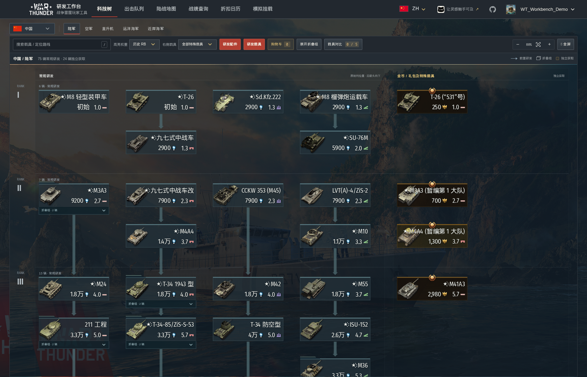
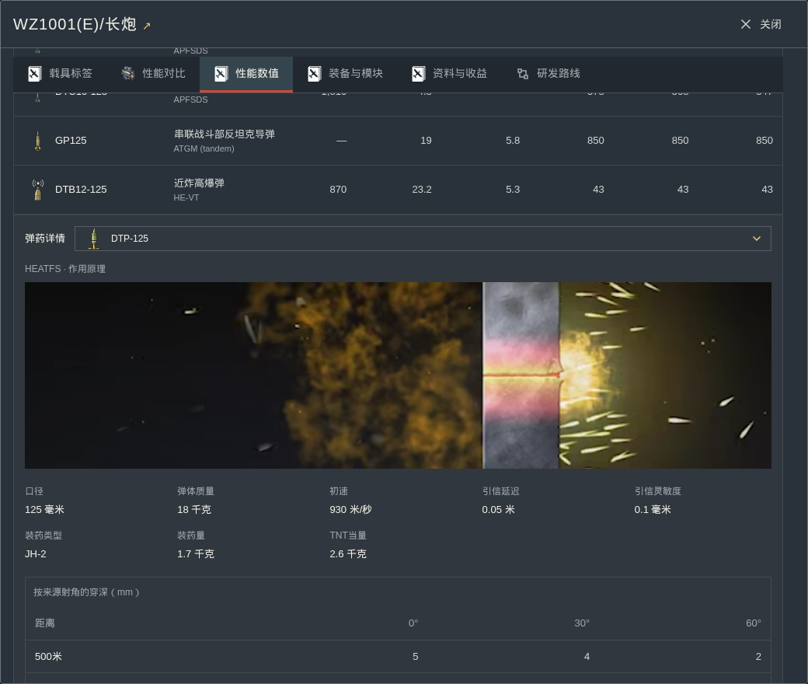
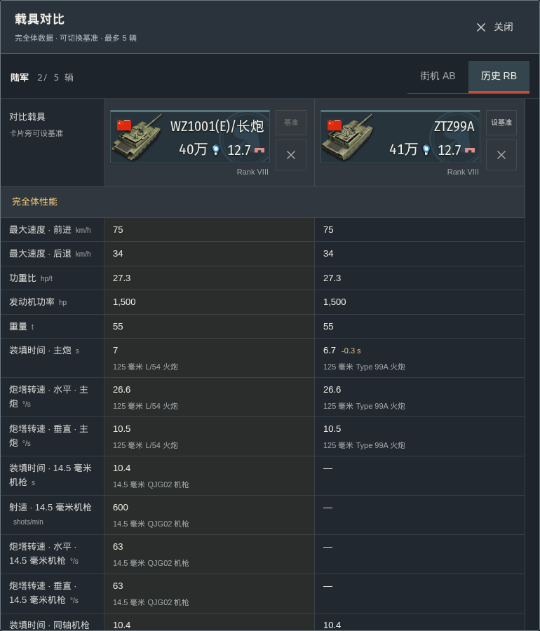
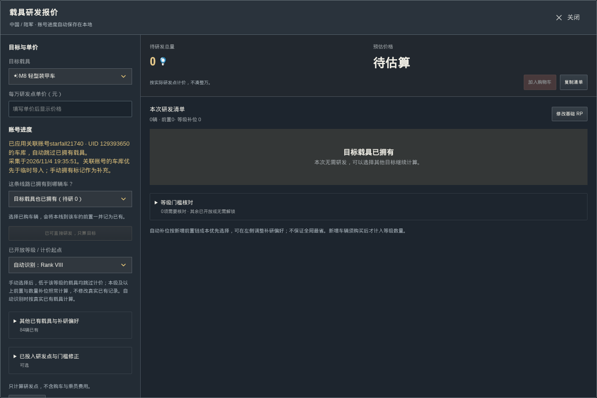
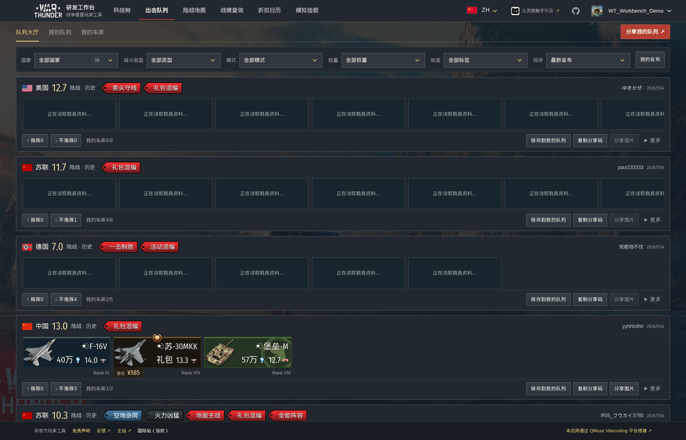
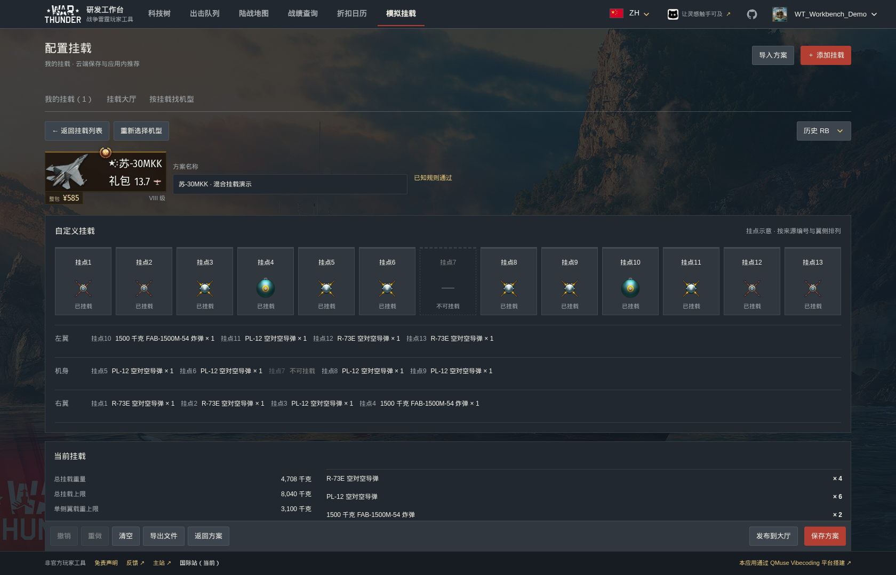
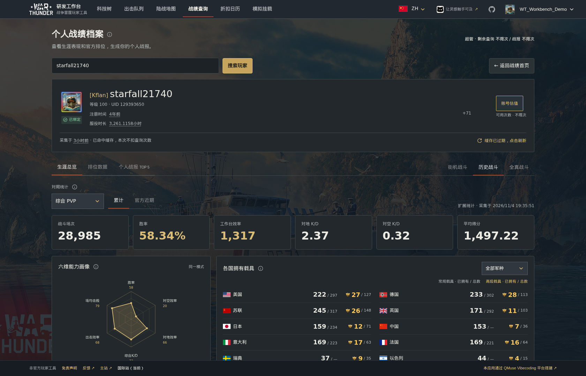
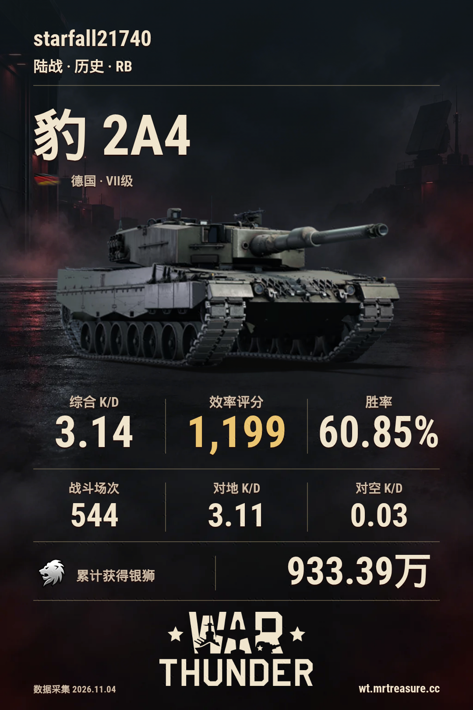
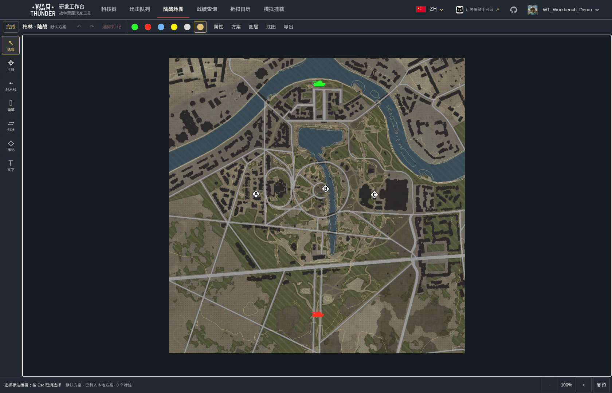
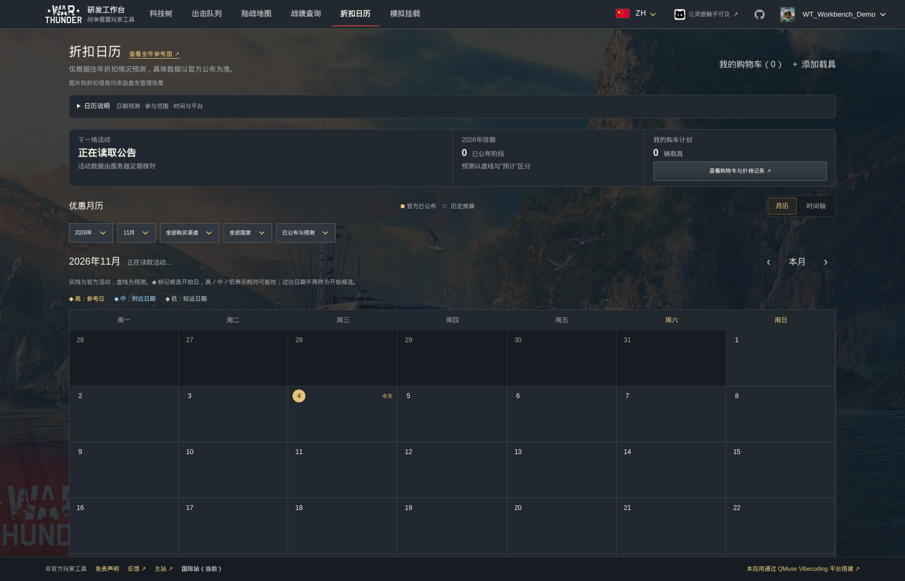

[简体中文](README.md) · [English](README.en.md) · [Русский](README.ru.md) · [日本語](README.ja.md)

# War Thunder — исследовательская мастерская

Справочник техники, планирование исследования, подвесы, наборы, статистика и маршруты на картах.

**[Основной сайт](https://wt.app.qmuse.pub/)** · **[Международный сайт](https://wt.mrtreasure.cc/ru/)** · [Руководство](docs/usage.ru.md) · [Сообщить о проблеме](https://github.com/MrTreasure/war-thunder-workbench/issues)

## Возможности

| Раздел | Назначение |
| --- | --- |
| Деревья техники | Десять наций, пять видов техники, исследование, модификации и сравнение |
| Наборы техники | Сохранённые составы, БР по режимам, обмен и сообщество |
| Симулятор подвесов | Узлы подвески, сравнение ракет, поиск носителей и расчёт баз |
| Статистика и отчёты | Карьера, недавние результаты, официальные рейтинги, ангар и карточки |
| Наземные карты | Варианты миссий, горизонтали, тактические отметки и экспорт |
| Календарь скидок | Официальные акции, ожидаемые сроки и список интересующей техники |

## Деревья и исследование

Наземная техника, авиация, вертолёты, большой и малый флот десяти наций. Доступны поиск, фильтры ранга и типа, выбор режима БР, раскрытие групп и связи исследования.

В подробностях указаны способ получения, проверенная полная цена набора, множители ОИ/СЛ, характеристики и предшественники. Сравнивайте до **пяти машин одного вида** по полностью улучшенным характеристикам, меняйте базовую машину и удаляйте участники сравнения.

Для танков доступны номинальная броня и боеприпасы с пробитием на **500, 1000 и 2000 м**. При выборе снаряда в подробностях показывается оригинальная игровая AVIF-анимация. Оснащение включает подтверждённые источником радары, оптику и модули; модули боеприпасов используют соответствующие изображения. Для самолётов и вертолётов перечислено доступное вооружение.

План исследования учитывает имеющуюся технику, открытые ранги и прогресс. Модификации расположены по исходным уровням и группам; для премиум-техники они по умолчанию открыты. Корзина нескольких целей учитывает общих предшественников один раз. Пользовательский тариф за ОИ — справочный пересчёт, неизвестная стоимость не заменяется нулём.

## Наборы техники

Сохраняйте несколько составов для каждой нации, меняйте порядок экипажей, фильтруйте и сортируйте по БР. Выбор нации показывает флаг и количество наборов. БР рассчитывается для соответствующего типа боя и режима.

В сообществе можно просматривать наборы, рекомендовать их или голосовать против, сохранять копии, выбирать метки и создавать изображения. Код обмена сохраняет нацию и порядок слотов. Изменения черновика применяются после сохранения.

## Симулятор подвесов

После входа откройте сохранённую конфигурацию или добавьте самолёт. Используйте штатные варианты или настройте отдельные узлы, контролируя нагрузку левого крыла, фюзеляжа и правого крыла. Параметры оружия доступны при наведении.

Можно сравнить до **шести ракет**, отфильтровать семейства и типы оружия, а также найти самолёты, несущие заданное количество. Рекомендованные конфигурации связываются с подробностями соответствующего самолёта.

Для поддерживаемых фугасных бомб, БР воздушных РБ и распространённых миссий с четырьмя возрождающимися базами отображаются урон, коэффициент награды за бомбометание и ожидаемое число уничтоженных баз для разных диапазонов боя. Подвесы сохраняются внутри приложения, отдельные коды обмена подвесами не используются.

## Статистика и личные отчёты

Открытые профили, карьера и официальные недавние показатели, K/D по видам техники, диаграммы, время игры и официальные рейтинги. Записи по машинам поддерживают фильтры, сортировку, страницы, таблицы и карточки.

Создавайте личные отчёты и карточки машин, выбирая фон и стиль комментария. Флаги соответствуют проверенной принадлежности машины: современная Германия, Российская Федерация и исторические флаги различаются независимо от выбранного фона. Для китайской техники всегда используется красный флаг с пятью звёздами.

Привязанный аккаунт показывает полный ангар, включая технику без вылетов. Знак владения не означает завершённые модификации. Справочная оценка отдельно показывает проверенные составляющие и позиции без цены; это не официальная цена и не предложение сделки.

## Карты и тактические схемы

Ищите карты, выбирайте миссию и сторону, просматривайте горизонтали, точки появления, захвата и исходные руководства. Рисуйте линии, кривые, стрелки, оборонительные линии, области, знаки и текст. Доступны отмена/повтор, несколько локальных схем, **PNG 2K/4K** и редактируемые файлы.

## Календарь скидок

Календарь и временная шкала показывают официальные акции и источники. Следите за техникой за ЗО и наборами магазина, проверенными обычными ценами, полной ценой набора в юанях и историей цен. Подтверждённые акции и исторические прогнозы показаны раздельно.

## Языки, сохранение и конфиденциальность

Международный сайт поддерживает китайский, английский, русский и японский на компьютерах и телефонах. Гостевые планы сохраняются в браузере; после входа планы, корзина, наборы и настройки наблюдения могут синхронизироваться. Для симулятора подвесов нужен вход.

Схемы карт остаются локальными. При завершении передаются только данные рисунка; на сервере хранится последний действительный вариант для пользователя/устройства, карты, миссии и стороны. Снимки экрана и изображения не загружаются. Экспорт формируется в браузере. Для публичной статистики пароль Gaijin не требуется.

Скриншоты заново сняты с опубликованного китайского интерфейса. Версии, время и источники указаны в [списке изображений](docs/screenshots/README.md).

## Документация и права

[Руководство](docs/usage.ru.md) · [Документация](docs/README.md) · [Разработка](docs/contributing.md)

Данные и игровые ресурсы взяты из [официальной Wiki War Thunder](https://wiki.warthunder.com/), [магазина Gaijin](https://store.gaijin.net/) и официальных открытых источников; дополнительные материалы сохраняют авторство.

Это независимый неофициальный проект без поддержки Gaijin. Актуальные данные игры и официальные объявления имеют приоритет; оценки и прогнозы носят справочный характер.

Названия, товарные знаки, изображения, карты и оригинальные ресурсы War Thunder принадлежат Gaijin Entertainment или соответствующим правообладателям. [MIT](LICENSE) относится к оригинальному коду проекта и не перелицензирует сторонние материалы. Обращения правообладателей принимаются через [GitHub Issues](https://github.com/MrTreasure/war-thunder-workbench/issues).
