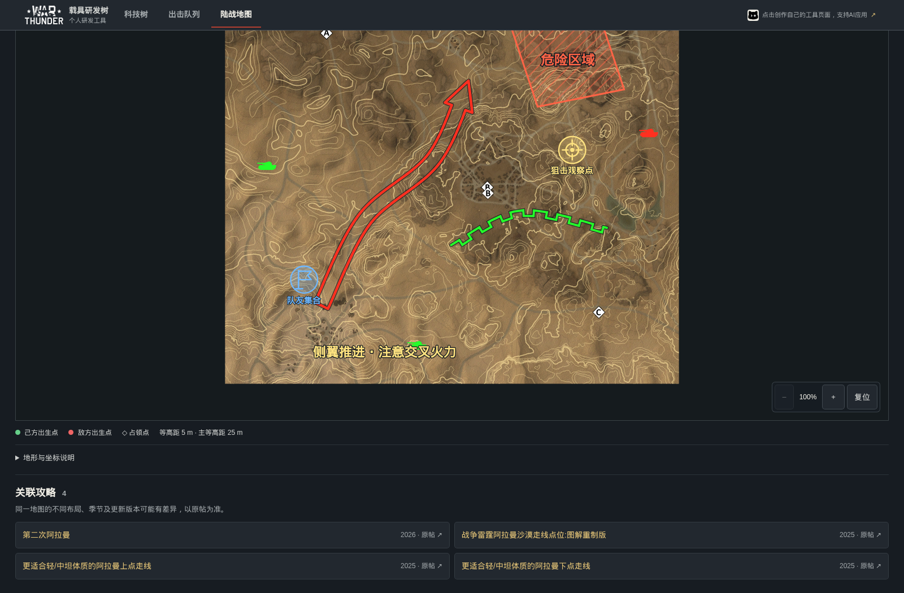

# 给战雷做了个地图工具：看地形、查攻略、自己画走线

开局前想看看地形，和队友讨论怎么绕、在哪里架炮，或者把看过的攻略整理成自己的路线图——于是给《战争雷霆》做了一个陆战地图工具。

这篇主要介绍两件事：**看地图，以及在地图上画自己的战术方案。** 电脑、手机都可以打开，不用登录。

## 先找到地图，再看任务布局

目前整理了 **55 张陆战地图、309 种任务布局**。

地图列表直接展示占领点缩略图，支持搜索中文名、英文名，也可以只看已经收录相关攻略的地图。同一张地图的不同占领布局会分开展示，查起来更直观。

点开后进入大图，可以切换任务布局和己方队伍，查看占领点与出生点，也能开关等高线、参考网格和布局范围。地图支持拖动、缩放与复位，方便对照山坡、谷地和各点之间的位置关系。

等高线适合辅助理解地形起伏，建筑遮挡、实际通行和对局位置仍要结合游戏判断。

## 想参考打法，也可以直接找攻略

收录了相关攻略的地图，会在详情下方展示 **“关联攻略”**，点击标题可以打开原帖。

可以先看作者的思路，再回到地图上对照点位和地形，画出适合自己车辆和队友配置的路线。攻略入口保留原作者和原帖来源；老攻略可能对应不同年份或布局，阅读时请留意版本差异。

## 把脑子里的路线画出来

地图详情里点 **“编辑走线”**，就能进入绘图界面。地图放在画布上，路线和说明也可以画到地图边缘以外。

下面的走线仅用于展示绘图功能，不是实战推荐路线。

线条可以直接拖出起点和终点，松手就完成。选中后自动打开属性面板，拖动端点改方向，在中间增加拐点，也可以换成平滑曲线，调整颜色与粗细。

画走线时能用到这些线型：

- 中空进攻箭头、开口方向箭头。
- 绿色防御阵线、前沿阵线。
- 撤退路线、补给线、射界线。
- 障碍线、反坦克壕线。

阵线支持翻转朝向，曲线也能使用战术线样式。工具面板是可收起的浮层，打开或关闭不会挤动地图。

## 狙击点、危险区域，单独标出来

除了线条，还可以放狙击点、观察点、伏击点、集结点、补给点等战术标记，也提供单独的战雷原生图标选择。

想强调某片区域，可以画矩形、椭圆或多边形，加上半透明颜色、斜线和文字说明，用来表达危险区、观察范围或需要留意的位置。

文字可以修改 **字体、字号、颜色、字重和斜体**，例如写清“队友集合”“先观察再推进”“注意交叉火力”。字体显示会随设备中可用的字体有所不同，导出图片会沿用画布上的字体设置。

## 同一张图，可以保留多套打法

例如给同一地图分别保存“正面推进”“侧翼绕行”“防守观察”，根据阵容和打法切换。

每个地图、任务布局和己方队伍都有各自的方案。支持：

- 新建空白方案。
- 把当前内容另存为新方案。
- 给方案重命名、切换或删除。
- 自动保存修改，继续编辑之前的内容。

旧的走线草稿会恢复到默认方案；导入绘图文件时会创建新方案，已有方案会保留。

方案保存在当前浏览器里，不会自动同步到别的设备。换设备、换浏览器，或准备清理网站数据前，记得先导出绘图文件。

## 画好后，发给一起玩的队友

完成后可以保存 **2K / 4K 图片**，发到群里讨论；也可以导出绘图文件，以后再导入继续改。

画错可以撤销、重做，选中标注后可以继续调整，也能一键清除当前方案的全部自定义标记。原有地图和任务点位会保留。

这是玩家自制的非官方工具。地图、攻略和战术符号用来辅助交流，具体打法还得结合车辆、队友和实际对局。

欢迎试试，也欢迎告诉我还希望加哪些地图功能。

**GitHub：** https://github.com/MrTreasure/war-thunder-workbench
